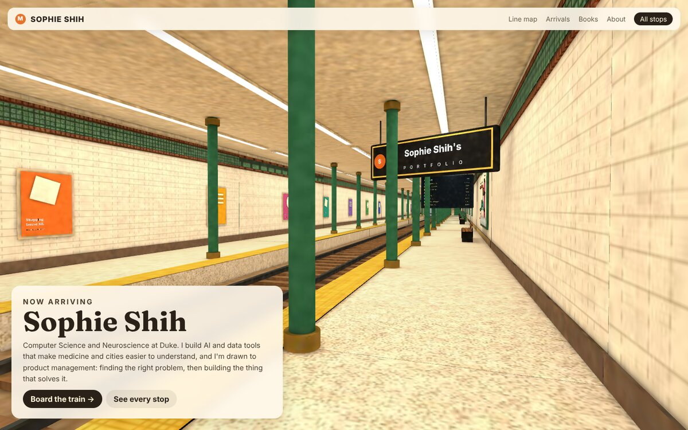

# Sophie Shih · Subway Portfolio



My portfolio as a sunny, slightly storybook New York subway station, cut open like a dollhouse so you can walk through it.
The station is modeled in **Blender** entirely from Python, its light is baked with
Cycles into textures, and the site plays it back in the browser with **Three.js**
inside a static **Next.js** app.

## How you move through it

The station is cut open like a dollhouse, so all three levels are on screen at once:
the street (About & contact) on top, the mezzanine (line map, arrivals board, books,
the stairs) in the middle, and the platform (title sign and seven projects) below.

| Way | What happens |
| --- | --- |
| Click a level or anything on it | The camera flies in through the cut to that spot (about a second) |
| Drag, or swipe, inside a level | Look around within limits |
| Left and right arrows, or the ← → buttons | Walk along the level from object to object |
| Esc or **Overview** | Go up one level (content, then the level, then the overview) |
| Projects and books | Open as a card that grows out of its lightbox; the train pulls in behind it |
| Lines (Data, Health, Words) | Dim the projects that aren't on the chosen line |
| **All stops** | A plain list of everything, one click away |

Deep links work too: `#folio` opens that project, `#about` goes to the street.
`prefers-reduced-motion` turns camera moves into cuts.

The old linear version (one long platform you ride along) is still in the repo:
`blender/layout.py` and `blender/build_station.py` build it, and `public/subway/station.glb`
is its output.

## Layout

```
app/                    Next.js app (static export)
components/subway/      Experience.tsx (UI, navigation) and scene.ts (Three.js, the dollhouse)
data/                   projects, books, writing, contact info
blender/                the 3D scene as code (see blender/README.md)
public/subway/          station-dollhouse.glb (baked), train.glb, layout-dollhouse.json
public/draco/           Draco decoder for the compressed meshes
```

## Run

```bash
npm install
npm run dev        # http://localhost:3000
npm run build      # static site in out/
```

## Rebuild the 3D scene

```bash
python3.13 -m venv .venv && .venv/bin/pip install bpy==5.2.3
.venv/bin/python blender/build_dollhouse.py preview    # dollhouse stills in blender/renders/
.venv/bin/python blender/build_dollhouse.py bake 2048 24 # station-dollhouse.glb + layout-dollhouse.json
.venv/bin/python blender/build_train.py                # train.glb
npm run compress                                       # Draco-compress the glb files
```

Inspired by Felix Rieseberg's process of describing a scene, having Claude write the
geometry as code, rendering a still, and iterating
([felixrieseberg.com/made-by-mechanical-means](https://felixrieseberg.com/made-by-mechanical-means/)).
